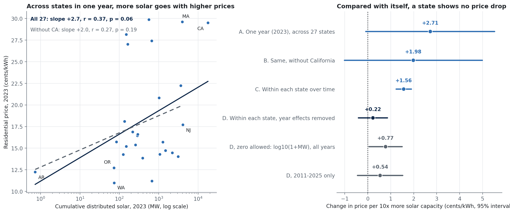

# dsa405-project: Do states with more distributed solar pay different residential electricity prices?

**Author:** Tanmayi Kurra (Unity ID `tkurra`), DSA 405, Fall 2026, NC State

## What this project is and what it found

I joined two public datasets, EIA residential electricity prices (51 jurisdictions, 2001-2025) and Berkeley Lab's distributed solar records (27 jurisdictions), to ask whether states with more distributed solar pay different average residential prices.

- **Across states in one year**, more solar goes with higher prices: in 2023 each tenfold increase in cumulative capacity goes with +2.7 cents/kWh (95% interval -0.1 to +5.5, r = 0.37, p = 0.057). The slope is positive in 24 of 25 years.
- **Within a state over time**, once year-wide shocks are removed, the estimate shrinks to +0.2 cents/kWh per tenfold increase (95% interval -0.4 to +0.9). Across four reasonable model choices it ranges from +0.2 to +1.0 and never shows lower prices.
- **What the data cannot say:** it covers 27 of 51 jurisdictions (24, including North Carolina, have no solar data), California is 56% of all systems, and it cannot show whether a household with solar pays less. The full discussion, including what is known versus suspected, is in [`REPORT.md`](REPORT.md).



## How to run

1. Clone the repo and open a terminal in the repo folder.
2. `pip install -r requirements.txt` (tested with Python 3.13, pandas 2.3.3).
3. Open `DSA405_002_FA26_P4_tkurra.ipynb` in Jupyter, VS Code or Cursor and choose **Restart & Run All**.

That is all that is needed. The notebook runs in about 10 seconds and writes `figures/p4_price_vs_solar.png` and `results/p4_results.json`. It reads the committed raw EIA file and the committed solar state-year summary.

**Optional: rebuild the solar summary from the original 252 MB file.** The zip is not in the repo (too large; it is in `.gitignore`). If you place it at `data/raw/LBNL_distributed_solar_dataset_public.zip`, the notebook checks its SHA-256 against `data/raw/MANIFEST_LBNL.json`, streams all 3,995,665 rows (about a minute; needs the `unzip` command), and confirms the result equals the committed summary. To get the zip, follow the link in the Berkeley Lab user guide (https://bit.ly/trackingthesun2026) and click Google Drive's "Download anyway" button yourself. My code does not download it, because robots.txt on Google's download host disallows automated downloads; the P3 notebook shows that check.

## Data sources and terms

| Source | What I used | Link | Terms |
|---|---|---|---|
| **U.S. Energy Information Administration (EIA)**, Open Data API v2, electricity retail sales | Annual average residential price by state, cents/kWh, 2001-2025 | https://www.eia.gov/opendata/ | U.S. government work, listed as public domain on Data.gov. Cite EIA as the source. The free API key I used is not stored anywhere in this repo. |
| **Lawrence Berkeley National Laboratory (Berkeley Lab)**, "U.S. Distributed Solar and Storage Data" (Tracking the Sun), authors Galen Barbose, Naim Darghouth, Eric O'Shaughnessy, Sydney Forrester; public file dated 28-Jul-2026 | Install date, state, DC size and technology type for each system, aggregated to state-year | https://emp.lbl.gov/tracking-the-sun/ | **Records disagree.** The project page states no license; a Data.gov record I checked in P3 lists CC BY 4.0; the 2025 eScholarship record lists CC BY-NC-ND 4.0 (https://escholarship.org/uc/item/0zp741f0). I followed the strictest: non-commercial coursework use with attribution, the raw file is not redistributed, and the repo holds only state-year totals that I computed. |

## Repo structure

```
README.md                          this file
REPORT.md                          the P4 written report (9 sections)
P4_self_scored_rubric.md           self-scored rubric for P4
DSA405_002_FA26_P4_tkurra.ipynb    P4: raw data to final figure (run this one)
DSA405_002_FA26_P3_tkurra.ipynb    P3: acquiring the Berkeley Lab file, ethics checks, join design, verification
DSA405_002_FA26_P21_tkurra.ipynb   P2: EIA audit, cleaning log, data dictionary, provenance brief
requirements.txt
data/raw/                          untouched inputs: EIA raw CSV, MANIFEST_LBNL.json, SOURCES.md (the zip is not committed)
data/clean/                        derived tables: EIA clean CSV, tts_state_year_capacity.csv, tts_accounting.json
figures/p4_price_vs_solar.png      final figure
results/p4_results.json            every number the report cites
```
