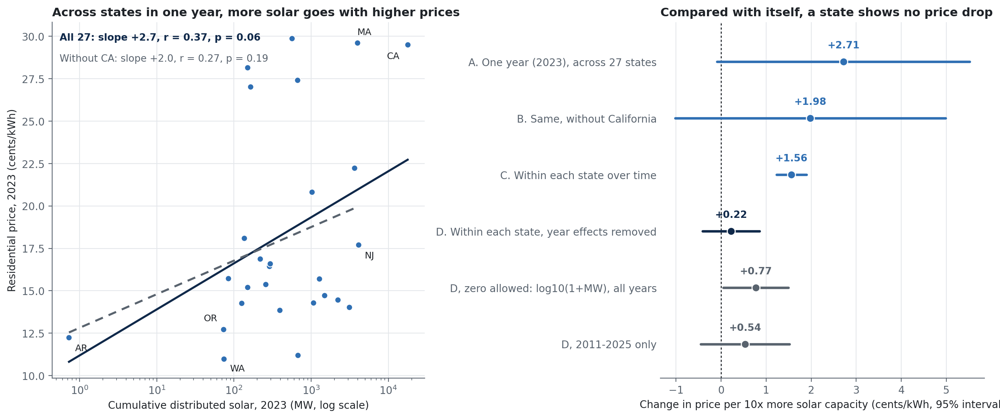

# Do states with more distributed solar pay different residential electricity prices?

**DSA 405 P4 Project Synthesis report** | Tanmayi Kurra (`tkurra`) | Fall 2026
Code: `DSA405_002_FA26_P4_tkurra.ipynb` (analysis, "P4 Step n" below) and `DSA405_002_FA26_P3_tkurra.ipynb` (acquisition, ethics, join design, "P3"). Every number in this report is printed by one of those notebooks and saved in `results/p4_results.json`.

---

## 1. Data motivation

**Question.** Do U.S. states with more distributed solar (rooftop and other small systems) pay different average residential electricity prices?

**Why it matters.** Two arguments are commonly made. One says distributed solar lowers prices by reducing the load the grid has to serve. The other says it raises them by spreading grid costs over fewer purchased kilowatt-hours. This project does not test either mechanism. It asks the first question that has to be answered before they can be: do the two things move together in the data, and in which direction?

**How the question changed once I had real data.**

| In the plan (README, P1) | With the real data | Why it changed |
|---|---|---|
| "...experience *lower* prices" | "...pay *different* prices" | The first results were positive, and the data cannot separate cause from effect, so a directional hypothesis would claim more than the data supports. |
| 51 jurisdictions (50 states and DC) | 27 jurisdictions | The Berkeley Lab public file has no records for 24 of them (Section 7). |
| "Installed solar" as a ready-made number | Cumulative installed kW (DC) that I built from install dates | The file has one row per system, not totals. I sum installs by state and year and take a running total (P4 Step 2). |
| About 5.3 million systems (the full Berkeley Lab database, cited in P1) | 3,995,665 systems | The public file leaves out confidential records. |

## 2. Sources, provenance and terms

| | **EIA retail electricity prices** | **Berkeley Lab Tracking the Sun** |
|---|---|---|
| **What** | Annual average residential price by state, cents/kWh, 2001-2025, 62 codes (51 jurisdictions plus 11 regional/national totals) | One row per installed distributed solar system: state, install date, DC size, technology type |
| **Producer** | U.S. Energy Information Administration. The price is revenue divided by kWh sold, so it includes all costs of delivered electricity and is not a utility rate. | Lawrence Berkeley National Laboratory: Barbose, Darghouth, O'Shaughnessy, Forrester, "U.S. Distributed Solar and Storage Data". Distributed solar there means residential systems, roof-mounted non-residential systems, and ground-mounted systems up to 5 MW-AC. |
| **Link** | https://www.eia.gov/opendata/ | https://emp.lbl.gov/tracking-the-sun/ |
| **How obtained** | EIA Open Data API v2 in P2, with a free API key that is not in the repo. The raw response is `data/raw/eia_retail_sales_raw.csv` (1,550 rows). | Public file `TTS_LBNL_public_file_28-Jul-2026_all.csv` (3,995,665 rows) inside `LBNL_distributed_solar_dataset_public.zip` (252,277,242 bytes, SHA-256 starting `75f3b4a5cdf6c018`). Downloaded **by hand once** from the link in Berkeley Lab's user guide; the code stops because robots.txt on Google's download host disallows my crawler (P3, Part 2). Checked 2026-11-19. |
| **Terms** | U.S. government data, listed as public domain on Data.gov. I cite EIA as the source. | **Records conflict.** The project page states no license. A Data.gov record I read in P3 lists CC BY 4.0. The 2025 eScholarship record for this dataset lists CC BY-NC-ND 4.0. I followed the strictest: coursework use, attribution, no redistribution of the raw file (the zip is gitignored), and only my own state-year totals are committed. I am not a lawyer and cannot resolve which record is authoritative. |
| **Ethics checks** | Per the A8 plan: API key kept out of code and out of git history | Honest User-Agent, one request per second, robots.txt checked and respected on every host, only four columns loaded (never city or ZIP), no personal data (P3) |

**Secrets check.** I searched all 15 commits of the repository's history for API-key names (`api_key`, `apikey`, `token`, `secret`, `password`), the EIA API host name, GitHub token prefixes and 40-character strings. The only hits were commit hashes and a `.gitignore` line. To repeat it: `git log -p --all | grep -n -i -E "api_key|apikey|token|secret|password|api\.eia\.gov"`.

## 3. Data dictionary and metadata (final analysis table)

This is the table the analysis uses (`merged` in P4 Step 3): 1,275 rows, one per jurisdiction per year (51 × 25). It updates the P2 dictionary with the three solar columns and the join flag.

| Variable | Type | Units | Valid range / levels | Missing | Notes |
|---|---|---|---|---|---|
| `year` | int | calendar year | 2001-2025 | 0 | EIA `period` |
| `state_id` | string | 2-letter postal code | 50 states + DC | 0 | The 11 regional/national codes are removed (P2). Join key. |
| `state_name` | string | text | matches `state_id` | 0 | |
| `price_cents_kwh` | float | cents per kWh, **nominal** (not inflation-adjusted) | 5.58 to 43.03 | 0 after filling 1 cell | Annual average residential price. Alaska 2016 was missing and was linearly interpolated; Alaska has no solar data, so that value is never used in a model. |
| `capacity_kw_cum` | float | kW DC, cumulative | 0 to 21.4 million (CA 2025); NA where no data | **600 rows (24 jurisdictions × 25 years)** | Running total of `PV_system_size_DC` by state, from installs dated up to each year-end. **NA means "not in the Berkeley Lab file", never zero.** |
| `systems_cum` | float | count of systems, cumulative | 0 upward; NA as above | 600 rows | Running count of installed systems. |
| `_merge` | category | join flag | `both` (675), `left_only` (600), `right_only` (0) | 0 | Evidence for the join accounting (Section 5). |
| `mw`, `log_mw` | float | MW; log10 of MW | `log_mw` defined only where `mw` > 0 | | Created in P4 Step 4 for the models. |

Columns dropped from the analysis table since P2: `sector_id`, `sector_name`, `price_units`, each with a single value (`RES`, `residential`, `cents per kilowatt-hour`). They remain in the committed clean CSV.

The solar summary (`data/clean/tts_state_year_capacity.csv`, 756 rows = 27 jurisdictions × 1998-2025) has `state`, `year`, `kw_added`, `n_added`, `capacity_kw_cum`, `systems_cum`.

## 4. Data cleaning

**EIA (P2, rebuilt and checked in P4 Step 1).** Raw 1,550 rows. I removed the 275 rows (11 codes × 25 years) that are regional or national totals, because leaving them in would double-count states. I renamed columns to snake_case, set types, and filled the one missing price by interpolating Alaska's 2015 and 2017 values. The notebook rebuilds the clean file from the raw file and fails if it differs from the committed one. Result: 1,275 rows.

**Berkeley Lab (P3 and P4 Step 2).** Every one of the 3,995,665 rows falls into exactly one bucket and the buckets add up:

| Bucket | Rows | Why |
|---|---|---|
| Read | 3,995,665 | |
| Dropped: storage-only systems | 52,922 | They have no solar panels, so they are not solar capacity |
| Dropped: size of -1, 0 or missing | 4,913 | -1 is a missing-value code; summing it would subtract capacity |
| Dropped: unusable state or year | 0 | Checked, none found |
| **Kept** | **3,937,830** | Of these, 230,106 have technology type "redacted"; I kept them because they still have a state, a date and a size |

I then summed size and counted systems by state and year, filled state-years with no installs with a real zero, and took the running total. Alternatives I considered: setting unmatched states to zero capacity (rejected: it would claim "no solar" where the truth is "not in the file"); an inner join (rejected: Section 5).

**Model-data choice.** The log of capacity is undefined at zero. 53 of the 675 matched state-years (13 states, all in 2001-2010) have zero cumulative capacity, so the models use the other 622. P4 Step 4 repeats the main model without this restriction and the answer moves (Section 6).

## 5. Integration and verification

- **Keys and grain.** `(state_id, year)`; one row per jurisdiction per year on both sides after aggregation; relationship one-to-one.
- **Join type: left, from EIA, `validate="one_to_one"`.** The question is about price, so every price row stays. An inner join would have dropped 600 rows and made a 27-state result look national.
- **Accounting.** 1,275 rows out = 1,275 in; 675 matched, 600 unmatched (24 jurisdictions with no solar data), 0 solar-only rows, so no solar jurisdiction was lost to the left join (the notebook checks that none is missing from EIA).
- **Nine checks in `verify()`:** row count, duplicate keys, one row per state per year, no negative capacity, price within 1-100 cents/kWh, cumulative capacity never decreasing, a state is matched in all years or none, no solar jurisdiction missing from EIA, and the row accounting from Section 4 reconciles. It passes on the real data.
- **Mutation tests.** A copy with one duplicated row fails 3 checks (row count, duplicate keys, grain). A copy with one capacity set to -1 fails 2 (negative capacity, decreasing cumulative). The failure lists are printed in P3 and again in P4 Step 3.
- **What this does not verify.** The checks confirm the tables line up; they cannot confirm the Berkeley Lab file is complete inside each state (Section 7).

## 6. Findings

**Summary.** States with more distributed solar have higher residential prices in a single-year comparison. That link shrinks to a small, uncertain positive number once each state is compared with itself. I find no evidence that more solar goes with lower prices. I do not find evidence that it makes no difference either.

*Slope = change in price (cents/kWh) for each tenfold increase in cumulative capacity. Intervals are 95%.*

| Model (P4 Step 4) | States | Slope | 95% interval | Reads as |
|---|---|---|---|---|
| A. 2023, across states | 27 | +2.71 | -0.09 to +5.51 (r = 0.37, p = 0.057) | Higher-solar states have higher prices, with an interval that just reaches zero |
| B. A without California | 26 | +1.98 | -1.02 to +4.98 | Weaker, so California matters but is not everything. Dropping any single state gives +1.98 to +3.12. |
| C. Each state vs its own average | 27 | +1.56 | +1.23 to +1.89 | Mostly a shared upward trend: solar and nominal prices both rose over time |
| **D. C plus year effects (main within-state model)** | 27 | **+0.22** | -0.41 to +0.85; bootstrap -0.34 to +0.91 | **No detectable price change when a state adds solar faster than other states** |

- A's slope is positive in **24 of 25** years (2001-2025) and its interval excludes zero in 15 of them.
- D is not one number. Changing how zero is handled (`log10(1 + MW)`, all 675 state-years) gives +0.77 (+0.05 to +1.50). Using only 2011-2025 gives +0.54 (-0.45 to +1.52), or +1.03 (-0.32 to +2.39) with `log10(1 + MW)`. All four are positive; three of the four intervals include zero; none is below zero. I report the range, +0.2 to +1.0 cents per tenfold increase, not the single smallest value.
- A doubling of capacity is +0.07 cents/kWh (-0.12 to +0.26) in the main D model. If solar in these states had a large price-lowering effect, D would likely show it. It does not.

**What I know, what I suspect, and what I do not know**

| Status | Statement | Basis |
|---|---|---|
| **Known** (measured) | In these 27 jurisdictions, higher-solar states have higher prices in most years | Model A, 24 of 25 years |
| **Known** | The within-state link is far smaller than the cross-state link, and the strongest-looking within-state number (C) is a shared trend | Models C and D |
| **Known** | The within-state estimate depends on modeling choices, +0.2 to +1.0 | The four D variants |
| **Suspected, not tested** | The cross-state link is partly reverse: high-price states make solar pay off sooner, so more households install | Pattern only: California and Massachusetts have both high prices (about 29.5 and 29.6 cents/kWh) and large capacity in the 2023 plot. I have no data on installation economics. |
| **Suspected, not tested** | Other state differences (fuel mix, policy, rate design, income) drive both prices and solar | None of these is in the data |
| **Unknown** | Whether solar changes prices in the 24 jurisdictions without data, or in a household's own bill | Not in the data |

**Limits of the estimates.** Standard errors are clustered by state with only 27 clusters, which can make intervals too narrow, so I added a bootstrap that resamples whole states. The within-state design cannot rule out something that changes inside a state at the same time as its solar (a rate case or policy change).

## 7. What is missing

**Who is missing (specific).** 24 of the 51 jurisdictions have no records in the public Berkeley Lab file: AK, AL, GA, HI, IA, ID, IN, KS, KY, LA, MI, MO, MS, MT, NC, ND, NE, NV, OK, SC, SD, TN, WV, WY. I do not know why. Consequences:
- Every conclusion applies to 27 jurisdictions. It says nothing about the 24, including North Carolina. The states that appear in the file may differ from those that do not in ways that also relate to prices, so the 27 may not represent the country.
- Within the 27, the data is concentrated: California holds 56.3% of all systems, then Arizona 8.5%, Texas 6.2%, New Jersey 5.8%, New York 4.6%. Model B shows how much one state matters.
- Confidential records were excluded by Berkeley Lab: the public file has 3,995,665 systems against about 5.3 million in the full database (P1). I do not know which states or system types lose the most.

**Also missing from the data.**
- **Latest years may be incomplete.** Systems added per year fall from 483,895 (2023) to 295,483 (2024) and 259,320 (2025). The cause is unknown. A reporting delay would explain it, but I have not confirmed that. If capacity is understated in 2024-2025 the later estimates are biased in an unknown direction.
- **Completeness inside a state.** Arkansas shows 0.7 MW in 2023, the lowest of the 27. I cannot tell whether that is real or incomplete reporting.
- **Prices are statewide averages in nominal dollars.** Year effects absorb common inflation in Model D, but model A is not inflation-adjusted across years (it compares states within one year, so this does not affect it).
- **No variables for the things that could drive both prices and solar:** fuel mix, policy, rate design, income, weather.

**One question this data cannot answer.** *Does a household that installs solar pay less for electricity?* The price is one average per state per year across all customers and has no household-level bill, so it cannot separate customers with solar from those without.

## 8. AI use log and reflection

I used Claude (Anthropic) throughout P3 and P4: writing and debugging code, designing checks, drafting slides and this report, and checking my work against the rubrics. The report text was drafted with Claude from the notebook outputs; I am responsible for it and checked each number against the notebook.

| # | What the model produced | What was wrong | How it was caught | What changed |
|---|---|---|---|---|
| 1 | Draft slide and summary wording describing Source 2 as national "installed solar systems" | It is project-level records from a public subset: 3,995,665 systems in 27 jurisdictions | I could not tell what "solar systems" meant in my own slides, asked, and checked the file's description and row counts | Reworded everywhere; the 27-jurisdiction limit became a central finding (Section 7) |
| 2 | Download code meant to follow Google Drive's "Download anyway" link | It failed with "no form I recognize", which looked like a parsing bug. The actual cause: robots.txt on `drive.usercontent.google.com` disallows my User-Agent (`can_fetch: False`). | Reading the printed robots.txt check, not the error message | The code now stops instead of fetching, and I downloaded the file by hand once. P3 documents this as drift from the plan. |
| 3 | A mutation test setting one capacity to -1 | The row it picked produced only one failure message instead of the two the checks should give | The printed failure list did not match what I expected | Row selection changed to a covered state's final year; both failures now show |
| 4 | P4 analysis code assuming every matched state-year could be logged | 53 state-years have zero cumulative capacity | An assertion in the notebook failed (622 usable rows, not 675) | Added the sensitivity runs: the within-state slope moves from +0.22 to +0.77 depending on how zero is handled. This is why Section 6 gives a range. |
| 5 | My P3 text said the Data.gov record lists CC BY 4.0 | A later search found a CC BY-NC-ND 4.0 record for the same dataset | Re-checking terms during P4, from the retrieved pages | Section 2 reports the conflict and follows the stricter term |

**Reflection.** The model was most reliable at routine pandas work and least reliable when a failure had a non-obvious cause (row 2) or when a description had to match the real data (row 1). The common pattern is that the first plausible explanation was wrong and the evidence was in printed output I could read myself. What I would do differently: record each data source's terms and coverage at collection time instead of reconstructing them later, and write assertions for assumptions before trusting a model. What I cannot judge on my own is whether the statistical choices (log scale, state and year effects, clustered and bootstrap intervals) are the best ones; I chose them because they answer distinct questions (Section 6 table) and because the result was reported with a range instead of one number.

## 9. Reproducibility

1. `git clone https://github.com/tiakurra/dsa405-project` and `cd` into it.
2. `pip install -r requirements.txt`.
3. Open `DSA405_002_FA26_P4_tkurra.ipynb` and choose Restart & Run All. About 10 seconds. It rebuilds the EIA table from raw and checks it against the committed one, loads the committed solar summary, joins, verifies, fits the models, and writes the figure and `results/p4_results.json`.
4. *Optional:* put the Berkeley Lab zip in `data/raw/` (downloaded by hand as described in the README). The notebook then verifies its SHA-256, rebuilds the solar summary from all 3,995,665 rows, and checks that it equals the committed summary. The notebook was executed top to bottom both ways with Jupyter on Linux (Python 3.13, pandas 2.3.3 and also 3.0.5): no errors, and the saved numbers agree to rounding.

Random seed: 405 (bootstrap only). Nothing in the pipeline is downloaded. The Berkeley Lab file is acquired manually, because the host's robots.txt disallows automation (P3). No keys, tokens or passwords are in the repository history (Section 2).
